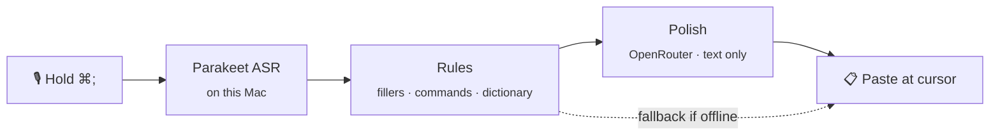

<div align="center">

# Yaptype

**Hold a key. Talk. Release. Clean text lands wherever your cursor is.**

Private-by-default voice dictation for macOS, built as an open alternative to Wispr Flow.


</div>

---

## Why Yaptype

- **Your voice stays on your Mac.** Recording and speech recognition run locally with NVIDIA Parakeet on CoreML.
- **Only text leaves the device, and only for polishing.** Transcripts go to OpenRouter for cleanup. Audio never does.
- **It never loses a dictation.** If polishing fails, Yaptype pastes the rules-cleaned transcript instead.
- **Light on resources.** Idle use is about half a percent of one CPU core and under 100 MB of memory.

## How it works



## Performance

Measured on a development Mac with `top` and `footprint`, while Yaptype was idle and during one dictation.

| | Idle | While dictating |
| --- | --- | --- |
| **CPU** | ~0.5% of one core | peaks around 54% of one core |
| **Memory (footprint)** | 92 MB | about 100 MB resident |
| **Threads** | 12 | 16 |
| **Network connections** | none | only when polishing |
| **Power impact** | 0.5 | low, short bursts |

Speech models take about 540 MB of disk space and download once on first launch.

## Requirements

- Apple Silicon Mac running macOS 15 or newer
- Xcode Command Line Tools: `xcode-select --install` (full Xcode is not needed)
- An [OpenRouter](https://openrouter.ai) API key for polishing. Optional; without it Yaptype runs rules-only.

## Quick start

```sh
git clone git@github.com:aradhyacp/YapType.git
cd YapType
./scripts/build.sh --install     # first build downloads dependencies; takes a few minutes
open /Applications/Yaptype.app
```

Then:

1. **Grant permissions** when macOS asks.
   - **Microphone** is required for dictation.
   - **Accessibility** is required for the global hotkey and for pasting into other apps.
   - **Contacts and Calendar** are optional. They boost names in recognition and stay on your Mac.
2. **Add your OpenRouter key** under **Settings › Polishing**. Skip this to stay fully local.
3. **Dictate.** Hold **⌘;** anywhere, speak, and release to paste. A quick tap starts toggle mode; tap again to stop.

## Controls

| Shortcut | Action |
| --- | --- |
| **⌘;** (hold) | Dictate; release to paste |
| **⌘;** (tap) | Start toggle mode; tap again to stop |
| **⌘⇧;** | Dictate with the alternate tone |
| **Esc** | Cancel the current recording |

## Tones

Every app uses **Professional** by default: sentence case, punctuation, and clean paragraphs.

Pick a different style per app under **Style › Apps**, or leave the list empty for consistent formatting everywhere. Built-in tones include Professional, Casual, and Verbatim.

## Models

| Version | Languages | Best for |
| --- | --- | --- |
| **v2** | English | Highest accuracy for English |
| **v3** | 25 European languages | Multilingual dictation |

Switch versions in **Models** or **Settings**. Models are stored in `~/Library/Application Support/FluidAudio/Models/`.

## Configuration

All settings live in one file:

```text
~/Library/Application Support/Yaptype/config.json
```

Start from the defaults in [`starter-config.json`](starter-config.json). Common fields:

| Field | What it controls |
| --- | --- |
| `openRouterAPIKey` | Polishing key. Empty means rules-only. |
| `openRouterModel` / `openRouterFallbackModel` | Primary and backup polishing models |
| `asrVersion` | `"v2"` (English) or `"v3"` (multilingual) |
| `dictionary` | Custom terms and how they sound, e.g. `"Yaptype: yap type"` |
| `tones` / `defaultTones` / `appTones` | Writing styles and per-app overrides |
| `memory` | Background about you that guides polishing |
| `keepClips` | Save each dictation's audio locally for evaluation |

> **Security note:** the OpenRouter key is stored in plain text in `config.json`. Keep that file private and never commit it. The file lives outside this repository, so `git` won't pick it up.

## Privacy

| Data | Where it goes |
| --- | --- |
| Microphone audio | Stays on your Mac. Never uploaded. |
| Speech-to-text | Runs on your Mac. |
| Transcript for polishing | Sent to OpenRouter as text, with your tone, dictionary, and memory. |
| History, stats, audio clips | Stored locally in `~/Library/Application Support/Yaptype/`. |
| Contacts and calendar names | Read only if you enable them. Stay on your Mac. |

Audio clips are saved only when `keepClips` is on.

## Command-line tools

Diagnostics run from the app binary:

```sh
Yaptype --selftest                  # deterministic text-rule checks
Yaptype --polishtest "um so we ship thursday"
Yaptype --dumpprompt professional   # show the exact prompt, without calling the API
Yaptype --eval                      # score saved dictations that have audio
Yaptype --mictest                   # check what your microphone delivers
Yaptype --context                   # what Accessibility sees in the front window
```

Replace `Yaptype` with `/Applications/Yaptype.app/Contents/MacOS/Yaptype`, or add that path to your shell.

## Troubleshooting

<details>
<summary><b>The hotkey does nothing</b></summary>

Grant Accessibility in **System Settings › Privacy & Security › Accessibility**, then quit and reopen Yaptype. Make sure no other app is using ⌘;.

</details>

<details>
<summary><b>"Microphone gave silence"</b></summary>

Pick another input in **Settings › Microphone**. The built-in mic goes silent with the lid closed. AirPods work, but they are narrowband.

</details>

<details>
<summary><b>Text is pasted but not polished</b></summary>

Add an OpenRouter key under **Settings › Polishing**. The menu bar status shows "Ready (rules only…)" when no key is set.

</details>

<details>
<summary><b>Text comes out lowercase or without punctuation</b></summary>

An app may have an override set to Casual or Verbatim. Remove it under **Style › Apps**, or choose Professional.

</details>

<details>
<summary><b>OpenRouter returns 429 or 5xx</b></summary>

Yaptype tries the fallback model, then pastes rules-only text. Free models can be rate-limited, so you can switch models in Settings.

</details>

<details>
<summary><b>The app won't open after a rebuild</b></summary>

Yaptype is ad-hoc signed for local use, not notarized. Right-click the app and choose **Open**.

</details>

## Contributing

Contributions are welcome. Check the [open issues](https://github.com/aradhyacp/YapType/issues), especially the ones labelled `good first issue` and `help wanted`.

## License

Licensed under the [PolyForm Noncommercial License 1.0.0](LICENSE). Free for personal, research, and other noncommercial use. See [NOTICE.md](NOTICE.md) for third-party components.
